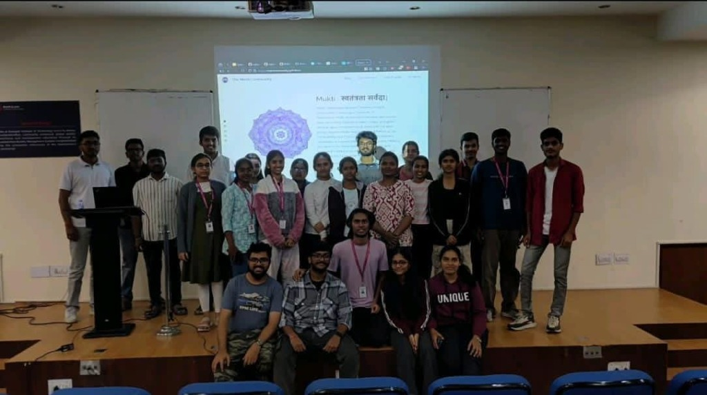
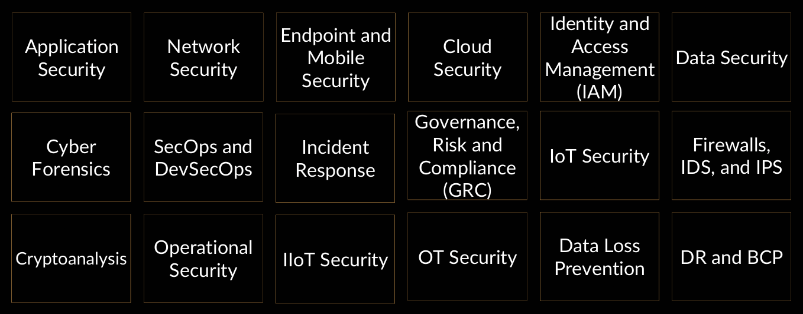
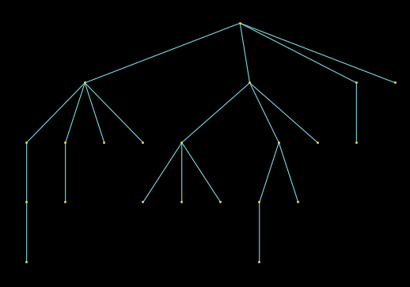

## welcome

On 24th September 2026, we hosted a deep-dive session on the cybersecurity landscape, practical tooling, and hardware-based exploitation. Whether you are curious about what security engineers actually do day-to-day, looking for realistic learning roadmaps, or wanting to see how small microcontrollers can compromise an endpoint, this session covered the ground without gatekeeping.

Here is the rundown of what was presented, demonstrated, and discussed during the event.

## what to expect

- What do cybersecurity professionals actually do?
- Importance of Linux in cybersecurity
- "The chain of topics" and the art of exploring (black box learning)
- Platforms to learn and practice from
- Black box tooling and reconnaissance
- Live demonstration of Storm-Breaker + zrok + Pico Ducky
- Industry-accepted certifications in cybersecurity
- Project Mania: hands-on CTF

## what do cybersecurity professionals actually do?

Cybersecurity is not just one uniform job—it is a massive field with distinct specializations. Depending on what you enjoy (breaking things, building defenses, analyzing packets, or setting policies), there is a dedicated domain.

The key industry disciplines include:

- **Application Security & SecOps/DevSecOps:** Integrating vulnerability scanning, secret detection, and code reviews directly into the build pipeline.
- **Network Security & Firewalls/IDS/IPS:** Monitoring ingress/egress traffic, inspecting anomaly signatures, and configuring zero-trust boundaries.
- **Endpoint & Mobile Security:** Hardening OS images, sandboxing apps, and managing enterprise device fleets.
- **Cloud Security & IAM:** Least-privilege identity access management, role policies, and cloud posture management.
- **Cyber Forensics & Incident Response (IR):** Dissecting breached systems, tracing IOCs (indicators of compromise), and performing memory dumps.
- **GRC (Governance, Risk & Compliance):** Crafting policies, auditing infrastructure against standards like ISO/IEC 27001, SOC 2, and NIST.
- **IoT & OT/IIoT Security:** Securing low-power connected hardware, SCADA networks, and industrial control systems.
- **Cryptanalysis & Data Loss Prevention (DLP):** Auditing cryptographic implementations and preventing unauthorized exfiltration of sensitive records.

## linux in cybersecurity

Linux is the foundational environment for almost every offensive and defensive security operation. If you want to work in security, getting comfortable with the terminal and POSIX internals is mandatory.

- **Community Support:** An unmatched global community of engineers continuously writing documentation, custom modules, and tooling.
- **Open-Source Transparency:** You have full visibility into the kernel source, networking stack, and system calls—no hidden telemetry or proprietary barriers.
- **Stable and Patch Management:** Linux package managers allow rapid deployment of kernel patches and security updates as soon as CVEs are published.
- **Dedicated Security Distros:** Operating systems like Kali Linux, Parrot OS, and BlackArch ship out-of-the-box with thousands of pre-configured penetration testing tools.

## chain of topics or the art of exploring

One of the biggest hurdles beginners face is: *"Where do I even start?"*

The secret is to not wait for a complete, exhaustive curriculum before building things. Instead, start with a tiny problem or utility, use **black box learning** (using an existing library or tool first without obsessing over every internal abstraction), and follow your curiosity into the **chain of topics**.

When you build a project, one question naturally sparks another:

1. Learning socket programming leads to inspecting network packets.
2. Packet inspection leads to discovering encryption protocols like TLS.
3. TLS leads to asymmetric key exchanges and hashing algorithms.
4. Hashing algorithms lead you to build secure password vaults or authentication APIs.

Let your curiosity guide the chain—practical projects build intuition faster than passive reading ever will.

## websites to learn from

If you want structured practice and real challenge platforms, these are some of the best places to spend your time:

- [MIT Missing Semester](https://missing.csail.mit.edu/): The missing CS curriculum covering shell scripting, vim, git, ssh, and system profilers.
- [Cryptopals](https://cryptopals.com/): Real-world crypto challenges demonstrating practical attacks against broken ciphers and MACs.
- [TryHackMe](https://tryhackme.com/): Interactive, browser-accessible virtual machines covering beginner to intermediate attack methodologies.
- [PicoCTF](https://cylabacademy.org/competitors.html): The premier Capture-The-Flag platform tailored for students to develop CTF problem-solving skills.
- [Microcorruption](https://microcorruption.com/): Embedded security and reverse engineering CTF where you debug MSP430 assembly to pick virtual smart locks.

## black box learning and cyber tools

During the session, we explored how open-source reconnaissance and testing tools can be evaluated:

- [maigret](https://github.com/soxoj/maigret): Collects comprehensive OSINT dossiers on an alias across thousands of online services and platforms.
- [zphisher](https://github.com/htr-tech/zphisher): An automated social engineering awareness tool used to demonstrate phishing attack surfaces.
- [Storm-Breaker](https://github.com/ultrasecurity/Storm-Breaker): Access management and social engineering framework capable of requesting camera, microphone, and geolocation permissions.
- [haveibeenpwned](https://haveibeenpwned.com/): Industry standard database to verify whether personal email addresses or credentials have been exposed in public database leaks.

## live demonstration: storm-breaker + zrok + pico ducky

The centerpiece of the session was a live demonstration showing how physical hardware and remote tunneling combine to deploy exploits against an endpoint in seconds.

### 1. hosting with zrok

Setting up local attack labs often runs into NAT or port-forwarding issues. We utilized [zrok](https://zrok.io)—an open-source tunneling utility built on OpenZiti—to create an instant, secure public tunnel directly to our local Storm-Breaker instance without modifying router firewall rules or exposing public IP addresses.

### 2. the pico ducky payload deployer

Instead of buying expensive commercial BadUSBs, we took a standard \$4 **Raspberry Pi Pico** microcontroller running the open-source [Pico Ducky](https://github.com/dbisu/pico-ducky) firmware.

When connected to a target computer via USB:

- The host operating system recognizes the RPi Pico as a standard Human Interface Device (HID keyboard).
- USB keystroke injection payloads bypass software-level USB storage restrictions because the OS natively trusts keyboard input.
- The Pico Ducky executes a scripted keystroke sequence: opens a terminal / run dialog, launches the browser pointing to the zrok tunnel, and triggers the payload in under three seconds.

This demonstration highlighted why physical security is just as critical as software firewalls: **if an attacker has physical access to an unlocked USB port, perimeter security no longer protects you.**

## industry accepted certifications

For students planning professional credentials to validate their skills:

- [ISC2 SSCP / CC](https://www.isc2.org/certifications/cc): Systems Security Certified Practitioner and Certified in Cybersecurity—great entry-level proofs of security fundamentals.
- [AZ-500 by Microsoft](https://learn.microsoft.com/en-us/credentials/certifications/azure-security-engineer/?practice-assessment-type=certification): Microsoft Certified Azure Security Engineer—essential for enterprise cloud security and IAM.
- [CEH by EC-Council](https://www.eccouncil.org/train-certify/certified-ethical-hacker-ceh/): Certified Ethical Hacker—broad baseline for penetration testing and industry terminology.
- [CompTIA](https://comptia.org): Security+ and Network+—recognized worldwide as standard vendor-neutral starting points.

## project mania: let's get our hands dirty

Theory only gets you so far. We set up an active target challenge for attendees to practice their skills hands-on:

- Solve the challenge: [satark_4 CTF](https://chrompycoder.github.io/satark_4/)

---

### doubts

For any doubts, questions, or bugs, reach out to Mukti Core on our [telegram group](https://t.me/MuktiCommunity) or ping the *Tech-help* section on the group.

### credits

San, Praneel, Mukti Core
