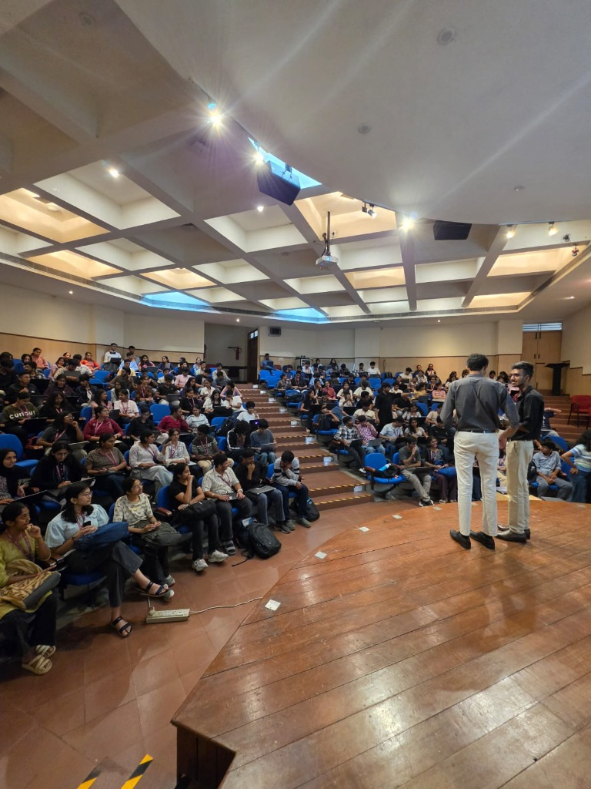

## welcome

On 5th November 2026, Mukti (the FOSS club of Ramaiah Institute of Technology) conducted **Git It Done** at the DES Hi-Tech Seminar Hall in collaboration with the Department of Computer Science & Engineering (CSE), RIT, and FOSS United.

The session was an interactive, laptop-first workshop that took students through version control essentials, open-source philosophy, and collaborative workflows with Git and GitHub.



## what to expect

- Why version control exists (the messy folder problem)
- Open source and the wider movement (FOSS roots, licensing, community)
- Personal software, vibe coding, and why version control matters more now
- Linux and the scale problem (how Git was born)
- Git vs GitHub
- The 3 areas of Git and hands-on workflow
- Branching, collaboration, and sending your first Pull Request (PR)
- Interactive workshop walkthrough guide

## why version control exists: the messy folder problem

Before version control, people tried encoding history into filenames: `project_final.zip`, `project_final2.zip`, `project_final_REAL.zip`.

This approach breaks down immediately:

- **No real history:** You cannot see what changed between copies without manually comparing files line by line.
- **No authorship:** No record of who made a specific change, when, or why.
- **Collisions:** Multiple people editing "the latest" file simultaneously overwrite each other's work.
- **No safe undo:** Deleting or overwriting a file means the previous state is permanently lost.

Cloud storage tools (Google Drive, Dropbox) sync copies automatically, but they do not record deliberate checkpoints, support parallel branching, or merge concurrent code edits. Version Control Systems (VCS) solve this problem systematically.

## open source and the wider movement

### what is open source?

Open source software is software whose human-readable source code is made public under a license that gives anyone the freedom to use, study, modify, and distribute it.

- **The Free Software root:** Richard Stallman launched the GNU project in 1983 and the Free Software Foundation in 1985. "Free" refers to freedom (liberty), not price.
- **FOSS:** Free and Open Source Software brings these traditions together. The "F" in Mukti stands for Free software.
- **Mukti:** *Mukti* is the Sanskrit word for liberation and freedom, matching the core ethos of software freedom.
- **Open Source Initiative (1998):** Formalized open-source definitions around the release of Netscape browser source code.

### licenses matter

Visible code without a license is not open source—default copyright law reserves all rights to the author.

- **Permissive licenses (MIT, Apache 2.0):** Allow anyone to use, modify, and redistribute the code, even in proprietary products, provided original copyright notices are retained.
- **Copyleft licenses (GPL):** Require derivative works to be released under the same license terms, ensuring freedom travels with the code.

### everyday software built on open source

- **Operating systems & Kernels:** Linux (powers servers, Android via AOSP, top 500 supercomputers, routers, Steam Deck)
- **Browsers & Engines:** Chromium (base of Chrome, Edge, Brave), Firefox
- **Languages & Frameworks:** Python, Node.js, React, PyTorch, TensorFlow
- **Everyday tools:** Git, VS Code (MIT core), Blender, VLC Media Player, LibreOffice

Linus's Law states: *"Given enough eyeballs, all bugs are shallow."* Open source enables shared infrastructure, eliminates vendor lock-in, and acts as the world's largest open classroom.

Non-code contributions—documentation, design, bug triage, localization, and organizing events—are just as critical as writing code.

## personal software and vibe coding

Software creation has become faster and cheaper with modern AI assistance. Individuals can now build single-purpose tools for themselves—what writer Robin Sloan described as software like a "home-cooked meal," and what is often referred to as "vibe coding."

In an AI-heavy software world, open source and version control become more important:

- Generated applications are built on open-source libraries and protocols.
- Fast code generation produces large volumes of changes quickly.
- When changes accumulate rapidly, having a precise history, audit trail, and safe undo mechanism via Git is essential to avoid breaking working systems.

## how git was born

In 1991, 21-year-old student Linus Torvalds released the Linux kernel under GPLv2. As thousands of developers around the globe began contributing patches, tracking changes via email became unmanageable.

From 2002 to 2005, the Linux team used BitKeeper (a commercial distributed VCS that offered free access to kernel developers). In April 2005, that relationship broke down.

Linus Torvalds took two weeks to design and write Git from scratch with clear architectural goals:

- **Distributed:** Every clone holds the entire project history; network access is not required for daily commits or diffs.
- **Speed & Scale:** Fast patching and branching tailored for thousands of contributors.
- **Cryptographic integrity:** Every commit, tree, and blob is indexed by a SHA-1 hash. History cannot be altered retroactively without invalidating downstream hashes.
- **Snapshots over deltas:** Git stores snapshots of files across time rather than recording file differences.

Since late 2005, Git has been maintained by Junio Hamano and remains the global standard for version control.

## git vs github

- **Git:** The local command-line tool running on your machine. Tracks local files, records commits, and manages branches offline.
- **GitHub:** A cloud-based hosting platform for Git repositories. Adds collaboration layers: issues, pull requests, code reviews, automated CI/CD (GitHub Actions), and hosting (GitHub Pages).

## the core workflow (hands-on)

### the three areas of git

1. **Working Directory:** Files currently on your disk that you edit.
2. **Staging Area (Index):** The draft snapshot of changes selected for the next commit.
3. **Repository (.git):** The permanent history of committed snapshots.

### essential commands

```bash
# Configure identity (one-time setup)
git config --global user.name "Your Name"
git config --global user.email "your.email@example.com"

# Initialize a new repository
git init

# Check working tree status
git status

# Stage files for commit
git add <filename>
git add .               # Stage all modified and new files

# Commit staged changes with a concise message
git commit -m "feat: add user authentication flow"

# View commit history
git log --oneline --graph

# Connect local repo to remote GitHub repository
git remote add origin https://github.com/<username>/<repo-name>.git
git branch -M main
git push -u origin main
```

### branching and pull requests (PR)

Branching isolates work so main branches remain stable:

```bash
# Create and switch to a feature branch
git checkout -b feature/event-page-updates

# Stage and commit your changes
git add .
git commit -m "docs: add hands-on workshop summary"

# Push feature branch to remote
git push -u origin feature/event-page-updates
```

Once pushed, navigate to GitHub to open a **Pull Request (PR)**, review code diffs, run automated checks, and merge.

## workshop guide and community

Students followed along with hands-on exercises using the dedicated event guide:

- **Interactive Event Guide:** [themdmohsin.github.io/git-it-done](https://themdmohsin.github.io/git-it-done/)
- **Mukti GitHub Community:** [github.com/MuktiCommunity](https://github.com/MuktiCommunity)


---

### credits

Conducted and mentored by Vijay Bharath TMS, Mohammed Mohsin Mahaboob Basha, and Mukti Core.
Special thanks to the Department of Computer Science & Engineering, RIT, and FOSS United.
