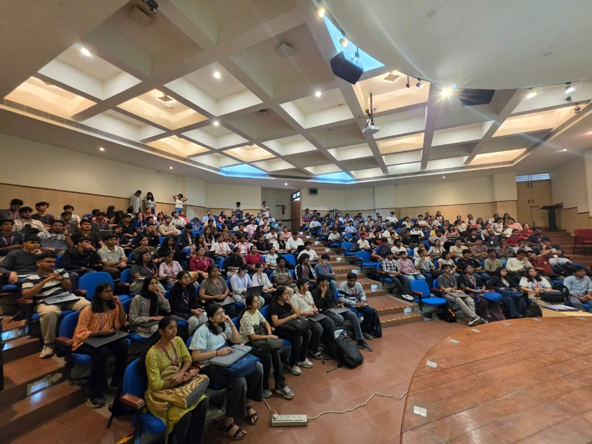
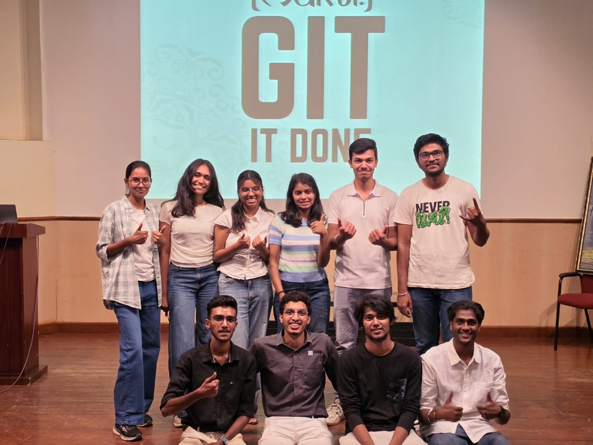

## welcome

On 5th November 2026, Mukti conducted **Git It Done** at the DES Hi-Tech Seminar Hall in collaboration with the Department of Computer Science & Engineering (CSE), RIT, and FOSS United.

The session was a terminal-first, hands-on workshop focused on version control mechanics, Git internal architecture, branching workflows, and open-source collaboration on GitHub.

## what to expect

- The concurrency and history problem in unversioned files
- How Git works under the hood (Snapshots, Hashes, and DAG)
- The three states of Git (Working Directory, Index, Repository)
- Core command-line workflow and commit hygiene
- Branching mechanics and merge conflict resolution
- Remote collaboration and the Pull Request (PR) lifecycle
- Interactive workshop walkthrough guide

## the concurrency and history problem

Managing code without a version control system by manually naming files (`final.zip`, `final2.zip`, `final_REAL.zip`) fails for technical reasons:

- **No atomic checkpoints:** You cannot diff state, inspect line-by-line changes, or roll back cleanly without manual inspection.
- **Race conditions & collisions:** When multiple developers edit files simultaneously, changes overwrite one another silently.
- **No cryptographic provenance:** Lacks verifiable authorship, commit timestamps, and cryptographically linked parents.

While cloud storage syncs files, it does not support branching, deterministic conflict resolution, or commit hashes. Version control systems solve this by making history immutable, traceable, and mergeable.

## how git works under the hood

Git is fundamentally a content-addressable filesystem with a VCS user interface built on top of it.

### snapshots, not deltas

Older systems (like CVS and SVN) store changes as file deltas (differences from a base version). Git thinks of its data as a set of snapshots over time. Every time you commit, Git records a snapshot of what all your files look like at that moment. To be efficient, if a file has not changed, Git does not store the file again—it links to the previously stored identical file.

### content-addressable storage

Every piece of data stored in Git is indexed by a 40-character SHA-1 checksum calculated from its content and header. The four primary Git object types are:

- **Blobs:** Store raw file contents (independent of filenames or permissions).
- **Trees:** Represent directories; map filenames and file modes to blob and sub-tree hashes.
- **Commits:** Contain a pointer to a root tree, parent commit hash(es), author/committer metadata, and the commit message.
- **Annotated Tags:** Permanent reference pointing directly to a specific commit hash.

Because commit hashes depend on the entire history leading up to them, tampering with any past commit automatically changes all subsequent hashes.

## the three states of git

Git manages files across three local areas:

1. **Working Directory:** The active sandbox on disk containing files you edit.
2. **Staging Area (Index):** A binary file (`.git/index`) holding the snapshot prepared for the next commit.
3. **Repository (.git directory):** The database where Git permanently stores compressed object snapshots and reference pointers.

```text
[ Working Directory ]  --- git add --->  [ Staging Area (Index) ]  --- git commit --->  [ Repository (HEAD) ]
         ^                                                                                     |
         +--------------------------------- git checkout -------------------------------------+
```

## core command-line workflow

### repository initialization and configuration

```bash
# Set author identity for commit metadata
git config --global user.name "Your Name"
git config --global user.email "your.email@example.com"

# Initialize a new Git repository in the current directory
git init
```

### staging and committing changes

```bash
# Check working tree and staging status
git status

# Inspect unstaged changes against the index
git diff

# Stage specific file or all modified/new files
git add <filename>
git add .

# Inspect staged changes prepared for commit
git diff --staged

# Create an atomic commit snapshot with a descriptive message
git commit -m "feat(auth): add token validation middleware"
```

### inspecting repository history

```bash
# View formatted single-line commit graph
git log --oneline --graph --decorate -n 10
```

## branching, merging, and pull requests

### branching mechanics

In Git, a branch is not a copy of files; it is a 41-byte pointer to a commit hash (`.git/refs/heads/<branch>`). When you switch branches, Git points `HEAD` to that branch reference and updates the working tree to match the target commit snapshot.

```bash
# Create and switch to a feature branch
git checkout -b feature/event-page-updates

# Work on files, stage, and commit
git add .
git commit -m "docs: add hands-on workshop summary"
```

### remote repository setup and pushing

```bash
# Add a remote origin pointing to GitHub
git remote add origin https://github.com/<username>/<repo-name>.git

# Rename default branch to main and push upstream
git branch -M main
git push -u origin feature/event-page-updates
```

### the pull request (PR) lifecycle

1. **Fork & Branch:** Fork the upstream project on GitHub and create a dedicated topic branch locally.
2. **Commit:** Keep commits small, isolated, and cleanly documented.
3. **Push:** Push the feature branch to your fork on GitHub.
4. **Open PR:** Submit a Pull Request comparing your fork's branch against upstream `main`.
5. **Code Review & CI:** Automated linters and test suites validate the changes, maintainers review diffs, and the branch is merged.

## workshop guide and community

Attendees brought their laptops and worked through hands-on exercises directly in the terminal:



- **Interactive Workshop Guide:** [themdmohsin.github.io/git-it-done](https://themdmohsin.github.io/git-it-done/)
- **Mukti GitHub Organization:** [github.com/MuktiCommunity](https://github.com/MuktiCommunity)



---

### credits

Vijay Bharath TMS, Mohammed Mohsin Mahaboob Basha, Mukti Core
